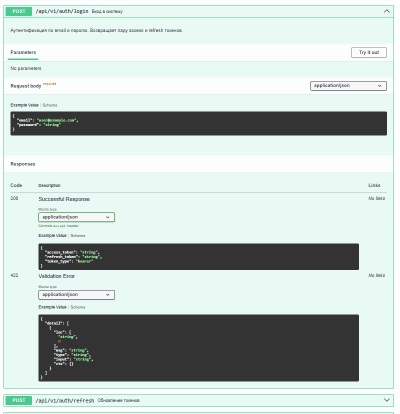
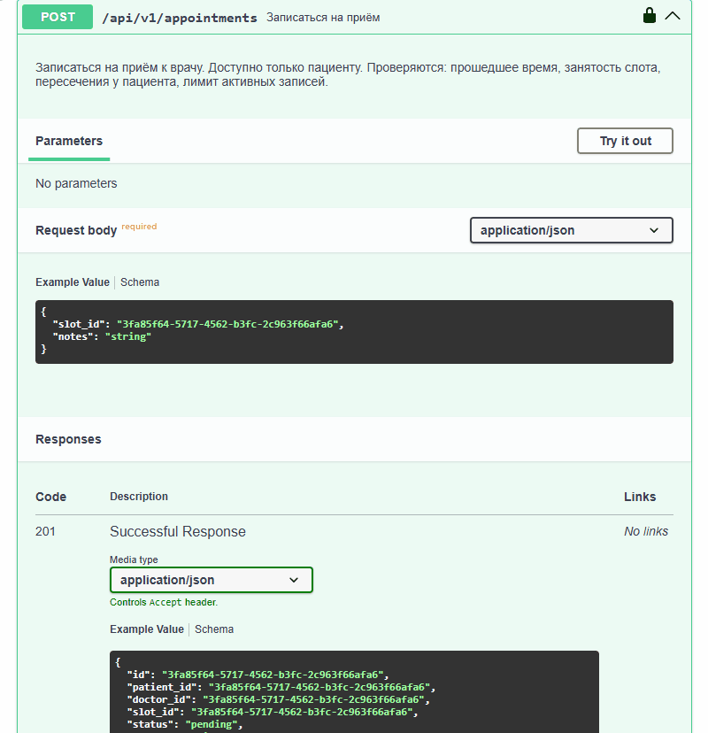
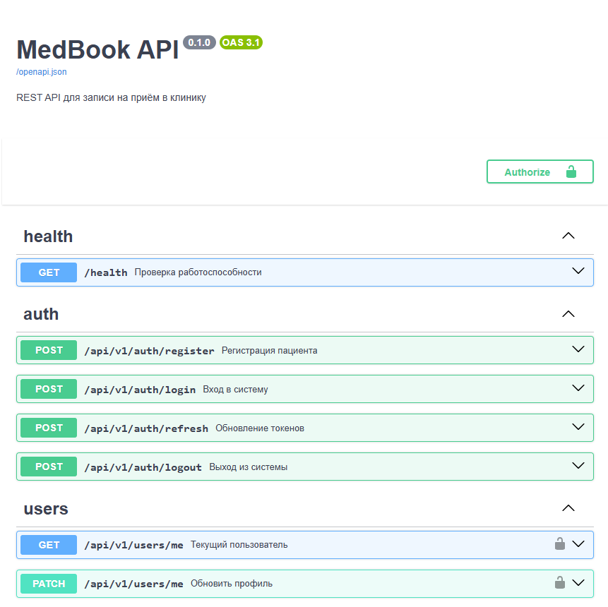
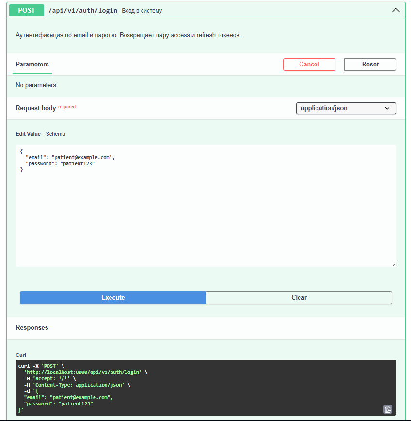
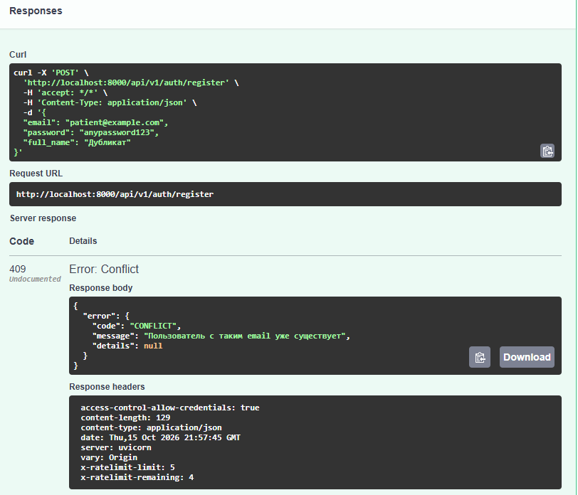
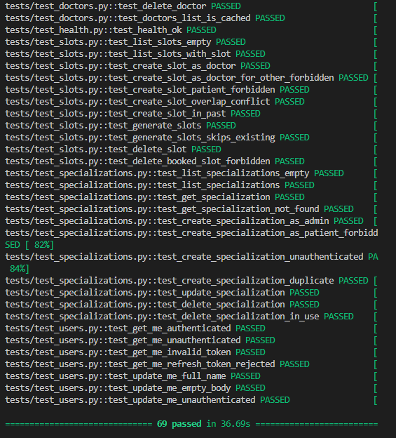

# MedBook API

[🇷🇺 Русская версия](README.ru.md) · 🇬🇧 English

[](https://github.com/VladimirTravkin/medbook-api/actions/workflows/ci.yml)
[](https://www.python.org/downloads/)
[](https://fastapi.tiangolo.com/)
[](https://www.postgresql.org/)
[](https://redis.io/)
[](https://www.docker.com/)
[](https://github.com/astral-sh/ruff)
[](https://opensource.org/licenses/MIT)

A production-ready REST API for clinic appointment booking.

Built with FastAPI, this API provides secure JWT authentication (with refresh token rotation), role-based access control (patient, doctor, admin), doctor scheduling, appointment booking with race-condition protection, Redis caching, and rate limiting.

**Live Demo:** [https://medbook-api-sayq.onrender.com/docs](https://medbook-api-sayq.onrender.com/docs)

**Demo credentials:**
- **Email:** `demo@example.com`
- **Password:** `demopassword123`

**How to authorize in Swagger:**
1. Open `POST /api/v1/auth/login`, click **Try it out**, paste the email and password, click **Execute**.
2. Copy the `access_token` value from the response.
3. Click **Authorize** (top of the page), paste the token into the **Value** field, click **Authorize**.

*(Note: The API is hosted on Render's free tier. The first request may take up to 50 seconds to spin up the instance.)*

---

## 📸 Demo

### Animated walkthrough

**Authentication flow:**


**Booking flow:**


### Screenshots

| Swagger Overview | Successful Login |
|---|---|
|  |  |

| Error Handling (409 Conflict) | Test Suite (70+ tests) |
|---|---|
|  |  |

---

## 💼 Business value

- **Appointments 24/7.** Patients browse doctors and book slots online without calling the clinic.
- **Secure by default.** JWT with refresh rotation, Argon2id password hashing, role-based access, and Redis-backed rate limiting.
- **Prevents double-booking.** Uses database row-level locks (`SELECT FOR UPDATE`) to ensure two patients cannot book the same time slot concurrently.
- **Production-ready.** Dockerized, automated migrations (Alembic), CI/CD via GitHub Actions, and deployed on cloud infrastructure.

---

## What it does

- 🔐 **JWT Authentication** — access + refresh tokens with rotation and revocation.
- 👥 **Role-Based Access Control** — patient, doctor, admin.
- 🩺 **Doctors Catalog** — public listing with filters, pagination, and Redis caching.
- 📅 **Slot Scheduling** — bulk generation of working hours for weeks ahead.
- 📝 **Appointment Booking** — enforces business rules (no past dates, no overlapping patient appointments, max active limits).
- 🚫 **Rate Limiting** — Redis-backed middleware on auth and booking endpoints.
- ✅ **Health Checks** — for monitoring database and Redis availability.

---

## Tech stack

- **Python 3.11+**
- **FastAPI** — async web framework
- **PostgreSQL 16** + **SQLAlchemy 2.0** (async) + **asyncpg**
- **Redis** (Upstash) — caching and rate limiting
- **Alembic** — database migrations
- **JWT** — python-jose (access + refresh)
- **pwdlib + argon2id** — password hashing
- **pydantic v2** + **pydantic-settings**
- **uv** — dependency management
- **Ruff** — linter and formatter
- **pytest** — 70+ tests with coverage
- **Docker** + **docker-compose**
- **GitHub Actions** — CI pipeline

---

## Architecture

The project follows a layered architecture:
`HTTP (Endpoints) → Services (Business Logic) → Repositories (Data Access) → Models (SQLAlchemy)`

- **Endpoints** handle HTTP requests, validation, and response formatting.
- **Services** enforce business rules (e.g., booking limits, cancellation windows).
- **Repositories** encapsulate database queries.

For more details, see [`docs/ARCHITECTURE.ru.md`](docs/ARCHITECTURE.ru.md) (in Russian).

---

## Quick start (Local)

> Requires Python 3.11+, [uv](https://docs.astral.sh/uv/), and [Docker](https://www.docker.com/products/docker-desktop/).

```bash
# 1. Clone the repository
git clone https://github.com/VladimirTravkin/medbook-api.git
cd medbook-api

# 2. Install dependencies
uv sync

# 3. Setup environment
cp .env.example .env
# Edit .env and set your own SECRET_KEY

# 4. Start PostgreSQL and Redis (Docker)
docker compose up -d

# 5. Apply database migrations
uv run alembic upgrade head

# 6. Run the server
uv run uvicorn app.main:app --reload --app-dir src
```

Open `http://localhost:8000/docs` for the interactive Swagger UI.

---

## Deployment (Render + Neon + Upstash)

The API is currently deployed in the cloud using entirely free tiers:

- **Application:** [Render](https://render.com) (Docker deployment).
- **Database:** [Neon](https://neon.tech) (Serverless PostgreSQL).
- **Cache/Queue:** [Upstash](https://upstash.com) (Serverless Redis).

Migrations are applied automatically on startup via `docker-entrypoint.sh`.

---

## Project structure

```text
medbook-api/
├── src/app/
│   ├── api/             # HTTP endpoints and dependencies
│   ├── core/            # Config, security, exceptions, redis, rate_limit
│   ├── db/              # SQLAlchemy base and session
│   ├── models/          # Database models
│   ├── repositories/    # Data access layer
│   ├── schemas/         # Pydantic schemas
│   ├── services/        # Business logic
│   └── main.py          # FastAPI application entrypoint
├── tests/               # Pytest test suite
├── alembic/             # Database migrations
├── scripts/             # CLI scripts (e.g., create admin)
├── docs/                # Screenshots, GIFs, architecture docs
├── Dockerfile
├── docker-compose.yml
└── pyproject.toml
```

---

## Contact

- **Telegram:** [@TravkinVladimir](https://t.me/TravkinVladimir)
- **Email:** [vpro68@mail.ru](mailto:vpro68@mail.ru)
- **GitHub:** [@VladimirTravkin](https://github.com/VladimirTravkin)

Open to freelance projects — Telegram is the fastest way to reach me.

---

## License

[MIT](LICENSE)
