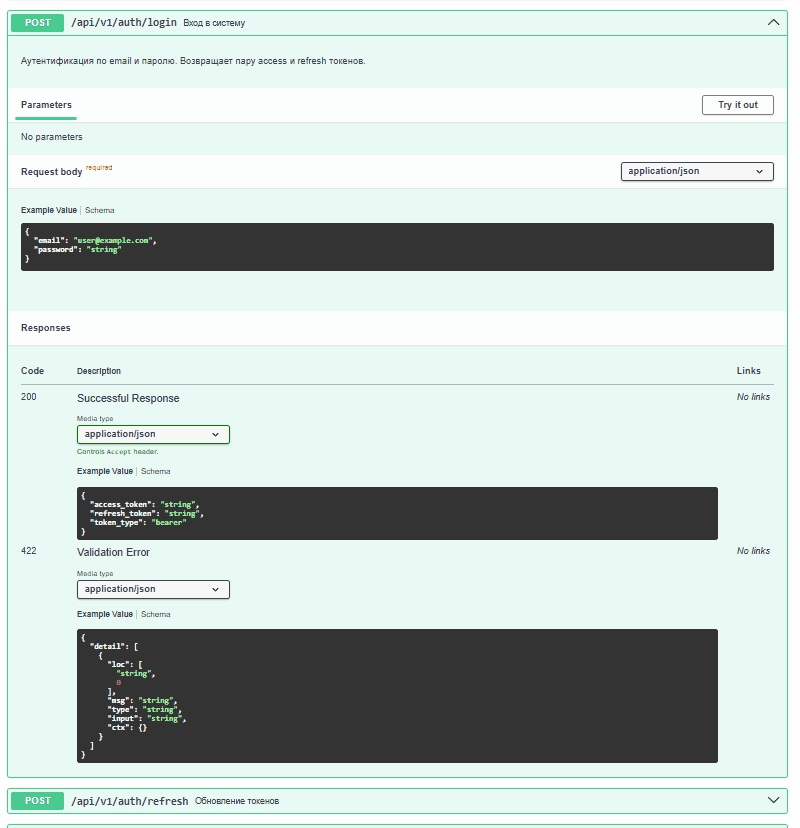
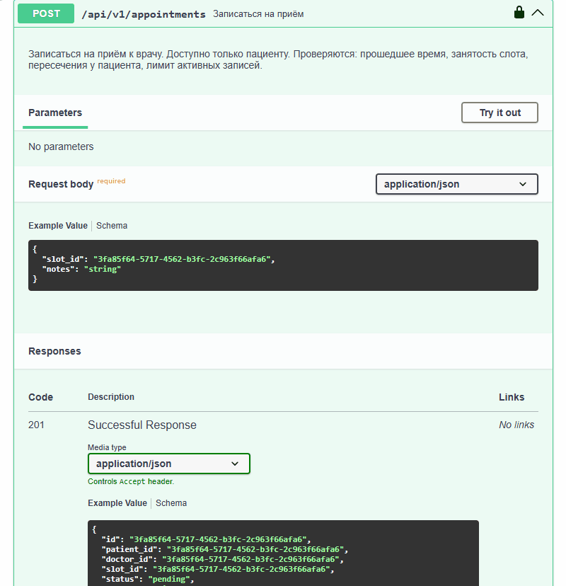
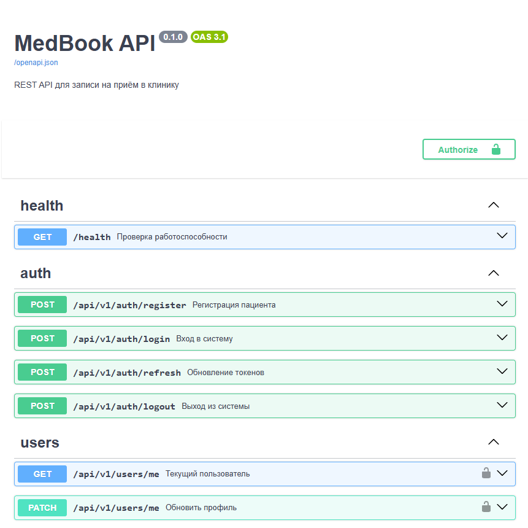
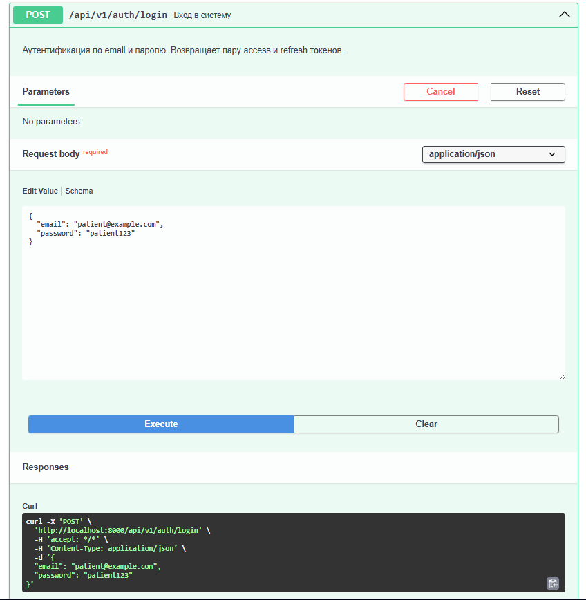
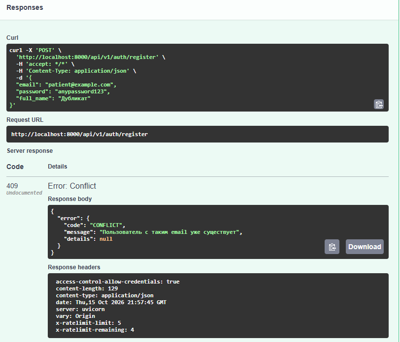
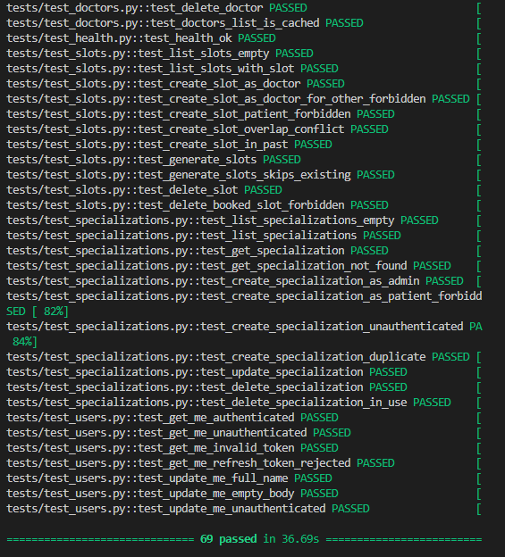

# MedBook API

[English](README.md) | **Русский**

[](https://github.com/VladimirTravkin/medbook-api/actions/workflows/ci.yml)
[](https://www.python.org/downloads/)
[](https://fastapi.tiangolo.com/)
[](https://www.postgresql.org/)
[](https://redis.io/)
[](https://www.docker.com/)
[](https://github.com/astral-sh/ruff)
[](https://opensource.org/licenses/MIT)

Production-ready REST API для записи на прием в клинику.

Построен на FastAPI и предоставляет безопасную JWT-аутентификацию (с ротацией refresh-токенов), ролевую модель доступа (пациент, врач, администратор), расписание врачей, бронирование приемов с защитой от состояния гонки, кеширование в Redis и ограничение частоты запросов.

**Живая демонстрация:** [https://medbook-api-sayq.onrender.com/docs](https://medbook-api-sayq.onrender.com/docs)

**Данные для входа (демо):**
- **Email:** `demo@example.com`
- **Пароль:** `demopassword123`

**Как авторизоваться в Swagger:**
1. Откройте `POST /api/v1/auth/login`, нажмите **Try it out**, вставьте email и пароль, нажмите **Execute**.
2. Скопируйте значение `access_token` из ответа.
3. Нажмите **Authorize** (вверху страницы), вставьте токен в поле **Value**, нажмите **Authorize**.

*(Примечание: API размещено на бесплатном тарифе Render. Первый запрос может занять до 50 секунд для запуска инстанса.)*

---

## 📸 Демонстрация

### Анимированная демонстрация

**Поток авторизации:**


**Поток записи на прием:**


### Скриншоты

| Обзор Swagger | Успешный вход |
|---|---|
|  |  |

| Обработка ошибок (409 Conflict) | Тесты (70+) |
|---|---|
|  |  |

---

## 💼 Ценность для бизнеса

- **Запись 24/7.** Пациенты просматривают врачей и бронируют слоты онлайн, без необходимости звонить в клинику.
- **Безопасность по умолчанию.** JWT с ротацией refresh-токенов, хеширование паролей Argon2id, ролевой доступ и ограничение запросов на базе Redis.
- **Предотвращение двойного бронирования.** Использует блокировки строк БД (`SELECT FOR UPDATE`), чтобы два пациента не могли забронировать одно и то же время одновременно.
- **Готовность к продакшену.** Docker, автоматические миграции (Alembic), CI/CD через GitHub Actions и деплой в облачную инфраструктуру.

---

## Что умеет

- 🔐 **JWT Аутентификация** — access + refresh токены с ротацией и отзывом.
- 👥 **Ролевой доступ** — пациент, врач, администратор.
- 🩺 **Каталог врачей** — публичный список с фильтрами, пагинацией и кешированием в Redis.
- 📅 **Расписание** — массовая генерация рабочих часов на недели вперед.
- 📝 **Запись на прием** — строгие бизнес-правила (нет записи в прошлое, нет пересечений у пациента, лимит активных записей).
- 🚫 **Rate Limiting** — ограничение запросов на базе Redis для эндпоинтов авторизации и бронирования.
- ✅ **Health Checks** — проверка доступности БД и Redis для мониторинга.

---

## Технологический стек

- **Python 3.11+**
- **FastAPI** — асинхронный веб-фреймворк
- **PostgreSQL 16** + **SQLAlchemy 2.0** (async) + **asyncpg**
- **Redis** (Upstash) — кеширование и rate limiting
- **Alembic** — миграции базы данных
- **JWT** — python-jose (access + refresh)
- **pwdlib + argon2id** — хеширование паролей
- **pydantic v2** + **pydantic-settings**
- **uv** — управление зависимостями
- **Ruff** — линтер и форматтер
- **pytest** — 70+ тестов с покрытием
- **Docker** + **docker-compose**
- **GitHub Actions** — CI пайплайн

---

## Архитектура

Проект следует слоистой архитектуре:
`HTTP (Endpoints) → Services (Бизнес-логика) → Repositories (Доступ к данным) → Models (SQLAlchemy)`

- **Endpoints** обрабатывают HTTP-запросы, валидацию и форматирование ответов.
- **Services** обеспечивают соблюдение бизнес-правил (например, лимиты записей, окна отмены).
- **Repositories** инкапсулируют запросы к базе данных.

Подробнее см. в [`docs/ARCHITECTURE.ru.md`](docs/ARCHITECTURE.ru.md).

---

## Быстрый старт (локально)

> Требуется Python 3.11+, [uv](https://docs.astral.sh/uv/) и [Docker](https://www.docker.com/products/docker-desktop/).

```bash
# 1. Клонировать репозиторий
git clone https://github.com/VladimirTravkin/medbook-api.git
cd medbook-api

# 2. Установить зависимости
uv sync

# 3. Настроить окружение
cp .env.example .env
# Отредактируйте .env и установите свой SECRET_KEY

# 4. Запустить PostgreSQL и Redis (Docker)
docker compose up -d

# 5. Применить миграции базы данных
uv run alembic upgrade head

# 6. Запустить сервер
uv run uvicorn app.main:app --reload --app-dir src
```

Откройте `http://localhost:8000/docs` для интерактивного интерфейса Swagger.

**Опционально — наполнить демо-данными:**

База данных стартует пустой. Чтобы создать демо-специализации, врачей и слоты расписания, выполните:

```bash
uv run python scripts/seed.py
```

Скрипт идемпотентный — безопасно запускать повторно. Он создаёт:

- 3 специализации (Терапевт, Кардиолог, Невролог)
- 3 врача с биографией и аватарами (пароль у всех: `doctor12345`)
- 480 слотов (на 2 недели вперёд, только будни, 9:00–18:00, сеансы по 30 минут)

---

## Деплой (Render + Neon + Upstash)

API развернуто в облаке с использованием полностью бесплатных тарифов:

- **Приложение:** [Render](https://render.com) (Деплой через Docker).
- **База данных:** [Neon](https://neon.tech) (Serverless PostgreSQL).
- **Кеш/Очередь:** [Upstash](https://upstash.com) (Serverless Redis).

Миграции применяются автоматически при запуске через `docker-entrypoint.sh`.

---

## Структура проекта

```text
medbook-api/
├── src/app/
│   ├── api/             # HTTP эндпоинты и зависимости
│   ├── core/            # Конфиг, безопасность, исключения, redis, rate_limit
│   ├── db/              # База SQLAlchemy и сессии
│   ├── models/          # Модели базы данных
│   ├── repositories/    # Слой доступа к данным
│   ├── schemas/         # Схемы Pydantic
│   ├── services/        # Бизнес-логика
│   └── main.py          # Точка входа приложения FastAPI
├── tests/               # Набор тестов Pytest
├── alembic/             # Миграции базы данных
├── scripts/             # CLI скрипты (например, создание админа)
├── docs/                # Скриншоты, GIF, документация архитектуры
├── Dockerfile
├── docker-compose.yml
└── pyproject.toml
```

---

## Контакты

- **Telegram:** [@TravkinVladimir](https://t.me/TravkinVladimir)
- **Email:** [vpro68@mail.ru](mailto:vpro68@mail.ru)
- **GitHub:** [@VladimirTravkin](https://github.com/VladimirTravkin)

Открыт к фриланс-проектам — Telegram самый быстрый способ связаться со мной.

---

## Лицензия

[MIT](LICENSE)
