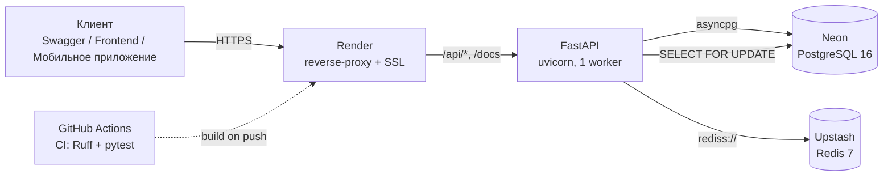
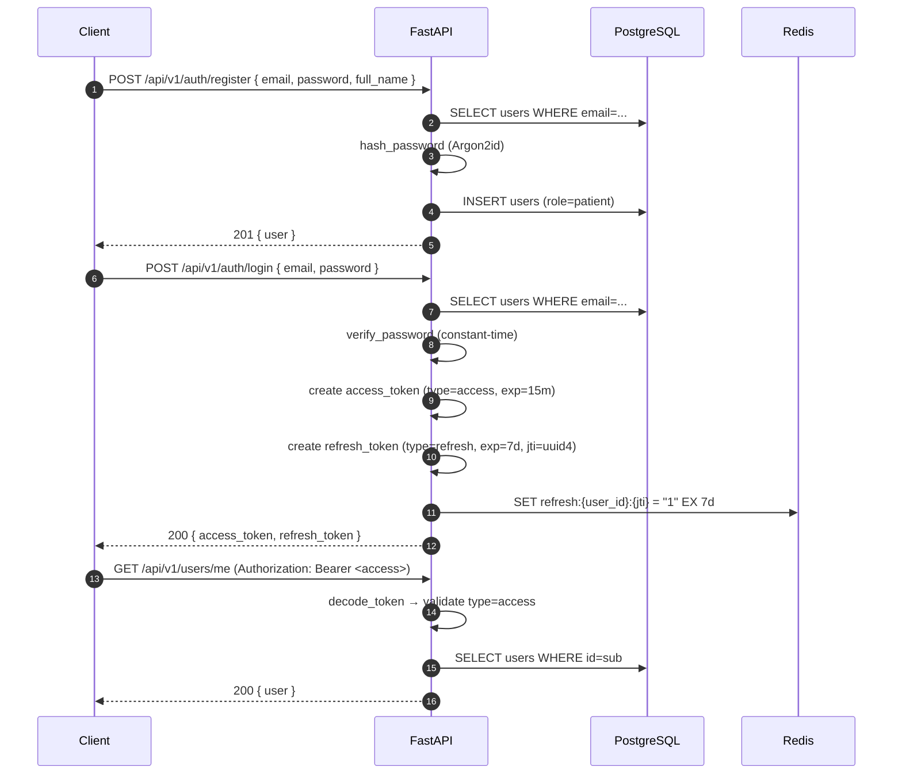
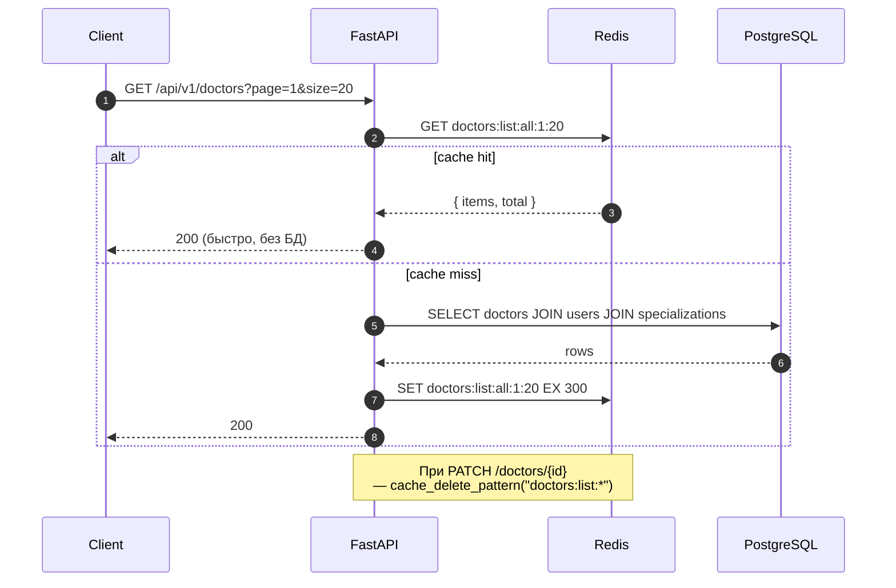
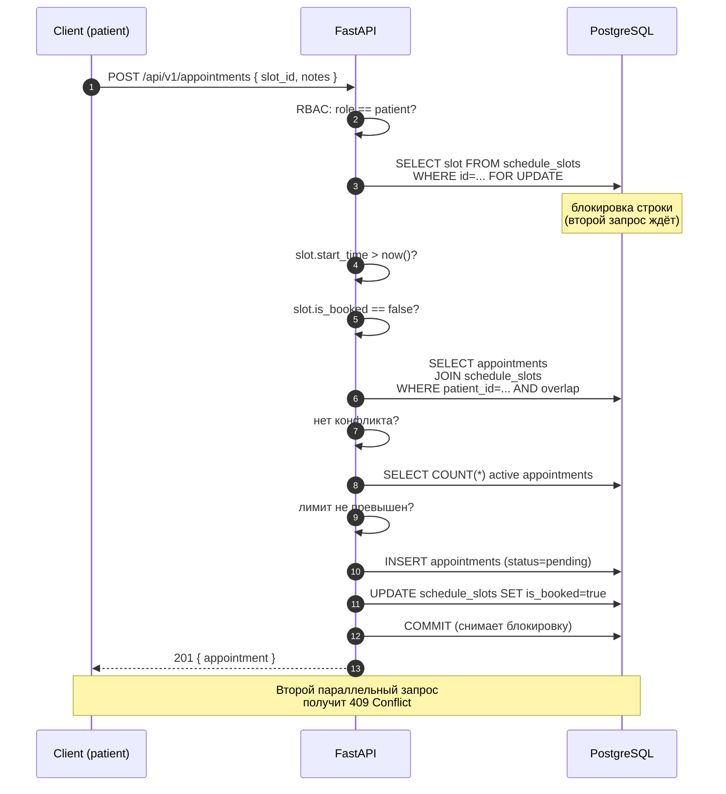
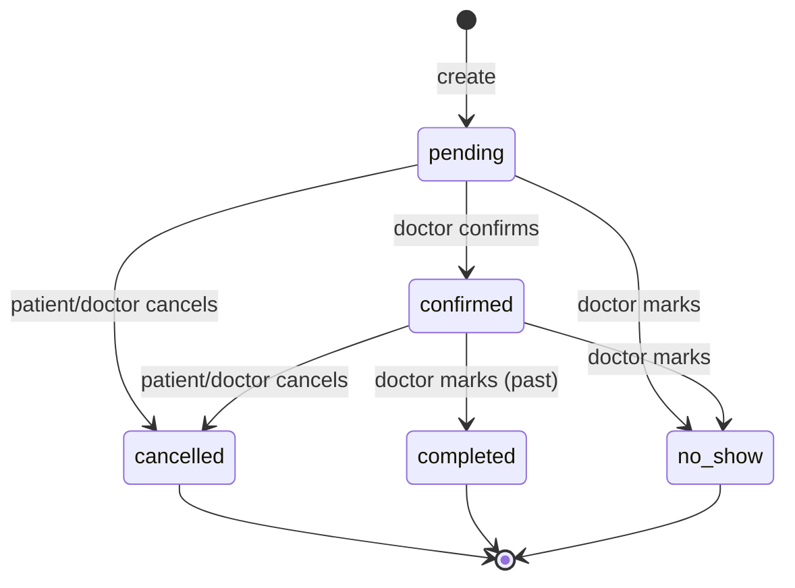
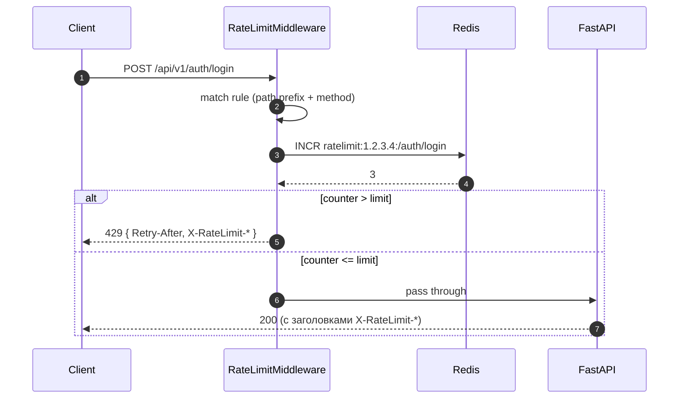
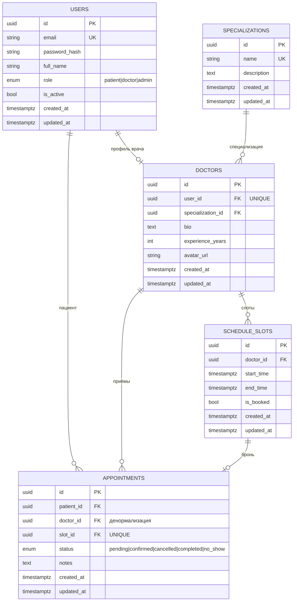
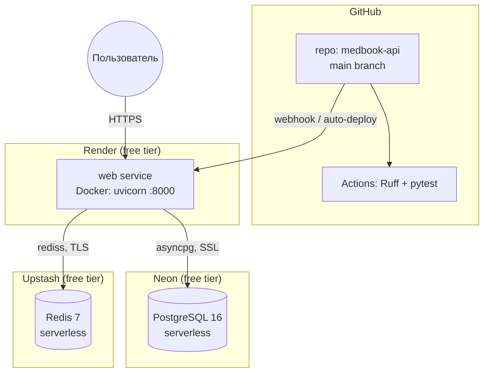

# Архитектура проекта: MedBook API

> Документ описывает архитектуру, потоки данных, модель данных и принятые
> инженерные решения. Цель — объяснить **почему** система устроена именно так,
> а не просто перечислить компоненты.

## Оглавление

1. [Обзор](#1-обзор)
2. [Компоненты и схема](#2-компоненты-и-схема)
3. [Потоки данных](#3-потоки-данных)
4. [Модель данных](#4-модель-данных)
5. [Безопасность](#5-безопасность)
6. [Инфраструктура](#6-инфраструктура)
7. [Деплой](#7-деплой)
8. [Допущения по нагрузке](#8-допущения-по-нагрузке)
9. [Вне рамок MVP](#9-вне-рамок-mvp)
10. [Trade-offs (ADR-lite)](#10-trade-offs-adr-lite)

---

## 1. Обзор

**Продукт.** REST API для записи на приём в клинику. Пациент просматривает
каталог врачей, выбирает свободный слот и бронирует приём. Врач управляет
своим расписанием и видит свои приёмы. Администратор управляет справочниками
и врачами.

**Ключевая идея.** Автоматизировать процесс записи, который обычно ведётся
по телефону. Пациент получает запись 24/7, клиника — меньше нагрузки на
администраторов и меньше двойных бронирований.

**Что входит в MVP:**

- Каталог специализаций и врачей (публичный, с фильтрацией и пагинацией).
- Расписание врачей: ручное создание слотов и массовая генерация на недели вперёд.
- Запись на приём с проверкой бизнес-правил (пересечения, лимиты, время).
- Отмена записи (с правилом N часов для пациента).
- Управление статусами приёма (pending / confirmed / cancelled / completed / no_show).
- JWT-аутентификация с ротацией refresh-токенов.
- Ролевой доступ: patient / doctor / admin.
- Rate limiting на эндпоинты авторизации и бронирования.
- Redis-кеширование каталога врачей.

**Стек:**

| Слой | Технологии |
|---|---|
| Backend | Python 3.11, FastAPI, SQLAlchemy 2.0 (async), asyncpg, Alembic, pydantic-settings, uvicorn |
| БД | PostgreSQL 16 (Neon в продакшене) |
| Кеш / Rate limit | Redis 7 (Upstash в продакшене) |
| Безопасность | JWT (HS256), python-jose, pwdlib + Argon2id, кастомный rate-limit middleware |
| Инфраструктура | Docker, Docker Compose, Render (app), Neon (БД), Upstash (Redis) |
| CI | GitHub Actions (Ruff + pytest) |
| Линтер | Ruff |

---

## 2. Компоненты и схема



**Роли компонентов:**

- **Render** — единая точка входа. Терминирует SSL (автоматический Let's Encrypt), проксирует запросы на uvicorn, управляет перезапусками контейнера.
- **FastAPI** — вся бизнес-логика: авторизация, каталог, слоты, записи, rate limiting. Полностью асинхронный (async SQLAlchemy + asyncpg).
- **Neon** — serverless PostgreSQL. Единственный источник истины по данным.
- **Upstash** — serverless Redis. Хранит refresh-токены (для отзыва), счётчики rate limiting и кеш врачей.
- **GitHub Actions** — CI на каждый push в `main`: линтер, тесты, безопасность.

---

## 3. Потоки данных

### 3.1. Регистрация, вход и JWT-сессии

Двухтокенная схема: access (15 минут) + refresh (7 дней). Refresh хранится в Redis
с `jti` — это позволяет **отзывать** токен (logout, ротация).



**Ротация refresh:** при `POST /auth/refresh` старый `jti` удаляется из Redis,
выдаётся новый. Если злоумышленник украл refresh и попытается им воспользоваться
после того, как жертва уже обновила токен — получит `401` (сигнал о компрометации).

**Logout:** удаляет `jti` из Redis. Токен становится невалидным, даже если срок
его жизни ещё не истёк.

### 3.2. Публичный каталог врачей с кешированием

Каталог врачей — самый частый запрос от пациентов. Кешируется в Redis на 5 минут.
Инвалидация — при создании / обновлении / удалении врача.



**Что кешируем:** список врачей и карточку конкретного врача (`doctor:{id}`).
**Что не кешируем:** слоты. Они меняются слишком часто (каждая запись = update),
кеш приносит больше вреда (устаревшие данные → `409` при попытке бронирования),
чем пользы.

### 3.3. Запись на приём (защита от двойного бронирования)

Ключевой сценарий с точки зрения бизнес-логики. Используется **блокировка строки
на уровне БД** (`SELECT ... FOR UPDATE`), чтобы два пациента не забронировали
один слот одновременно.



**Порядок проверок (важен):**

1. `404` — слот не существует.
2. `400` — слот в прошлом.
3. `409` — слот уже занят.
4. `409` — у пациента пересечение с другой записью (к другому врачу).
5. `409` — превышен лимит активных записей (`MAX_ACTIVE_APPOINTMENTS`).

Если проверки проходят — создаётся запись и слот помечается занятым **в одной
транзакции**. `COMMIT` снимает блокировку.

### 3.4. Отмена и смена статуса



**Правила:**

- Пациент может отменить **свою** запись не позднее `CANCELLATION_MIN_HOURS` (2 часа) до начала.
- Врач и админ — без ограничения по времени.
- При отмене `slot.is_booked` сбрасывается в `false` — слот снова доступен.
- Терминальные статусы (`cancelled`, `completed`, `no_show`) изменить нельзя.

### 3.5. Rate limiting

Кастомный middleware на Redis. Fixed window (`INCR` + `EXPIRE`) на ключ
`ratelimit:{ip}:{path}`.



**Конфигурация** (из `.env`):

- `/auth/*` — 5 запросов / 60 секунд (защита от брутфорса паролей).
- `POST /appointments` — 10 запросов / 60 секунд (защита от спама).
- Метод-специфично: `GET /appointments` **не ограничен** (листинг безопасен).

**Fail-open:** если Redis недоступен, запрос пропускается. Rate limiting не должен
становиться единой точкой отказа.

---

## 4. Модель данных



**Ключевые решения по модели:**

- **UUID v4 вместо int** — пациент не может угадать чужой `appointment_id` и
  обратиться к нему (защита от IDOR/BOLA). Злоумышленник не перебирает `1, 2, 3, ...`.
- **`slot_id` в `appointments` — UNIQUE.** На уровне БД гарантирует, что один
  слот = максимум одна запись. Даже если в коде будет баг, Postgres не даст
  создать две записи на один слот.
- **`doctor_id` в `appointments` — денормализация.** Дублируется из слота для
  быстрых запросов «мои приёмы у врача X» без JOIN.
- **`CheckConstraint` на слоты** — `end_time > start_time`. Защита на уровне БД.
- **Enum-типы (PostgreSQL)** — `user_role` и `appointment_status`. Типобезопасность
  на уровне базы.
- **`ON DELETE CASCADE`** для `doctor → user` и `slot → doctor`; **`RESTRICT`** для
  `appointment → slot` (нельзя удалить слот, на который есть запись).

---

## 5. Безопасность

### 5.1. Хеширование паролей

**Argon2id** через `pwdlib`. Выбран вместо bcrypt по трём причинам:

1. Argon2id — текущая рекомендация OWASP (bcrypt — «acceptable, если Argon2 недоступен»).
2. **Нет лимита 72 байта** (bcrypt молча обрезает длинные пароли — passphrase из
   менеджера паролей может быть усечён).
3. Устойчив к GPU-атакам (memory-hard).

Параметры: `m=65536` (64 MiB), `t=3`, `p=4` — современные значения по умолчанию.

### 5.2. JWT

- Алгоритм: **HS256**, секрет — `SECRET_KEY` из `.env` (генерируется через `openssl rand -hex 32`).
- Access TTL: **15 минут** — стандарт индустрии (OWASP, Auth0, Microsoft).
- Refresh TTL: **7 дней**, хранится в Redis с `jti` для отзыва.
- Проверка `type` в токене: access не принимается там, где нужен refresh, и наоборот.
  Это защита от подмены типа.

### 5.3. Ролевой доступ (RBAC)

- **patient** — регистрация, свои записи, отмена.
- **doctor** — управление своими слотами, приёмами; смена статуса.
- **admin** — управление справочниками, врачами, все записи.

Проверки реализованы **в двух местах:**

1. **На эндпоинте** — `Depends(require_admin)` — ранний отсев.
2. **В сервисе** — `_ensure_can_view()`, `_resolve_doctor_for_user()` — защита
   от «забыли проверку на новом эндпоинте».

### 5.4. Rate limiting

См. [3.5](#35-rate-limiting). Ключевые свойства:

- Метод-специфично (не блокирует `GET`).
- Fail-open при недоступности Redis.
- Заголовки `X-RateLimit-*` и `Retry-After` для клиента.

### 5.5. CORS и инфраструктура

- `allow_methods` и `allow_headers` — **явный список**, не `["*"]`.
- PostgreSQL и Redis **не проброшены наружу** в продакшене (`docker-compose.yml`
  без `ports`, `docker-compose.override.yml` — только для локальной разработки).
- `APP_DEBUG=false` в продакшене — SQL-логи с параметрами не утекают в stdout.

### 5.6. Защита от BOLA / IDOR

- **UUID v4** как первичные ключи — невозможно угадать.
- **Проверка владельца** на каждом эндпоинте (`appointment.patient_id == current_user.id`).
- **404 вместо 403** в некоторых случаях — не подсказываем атакующему, что объект
  существует (например, при запросе чужого приёма по id).

---

## 6. Инфраструктура



**Особенности облачной инфраструктуры (free tier):**

- **Render:** бесплатный инстанс с 512 МБ RAM. Засыпает после 15 минут бездействия;
  первый запрос после «сна» занимает 30–50 секунд (cold start). Приемлемо для
  портфолио и демо, но не для боевой нагрузки.
- **Neon:** serverless PostgreSQL с автоскейлингом. Соединение через **пулер**
  (`-pooler` в хосте) — критично для serverless, иначе коннекты кончаются.
- **Upstash:** Redis с TLS (`rediss://`) и паролем. Регион — тот же (US East),
  что и у Render/Neon, для минимизации latency.
- **Автоматические миграции:** `docker-entrypoint.sh` запускает `alembic upgrade head`
  перед стартом uvicorn. Если миграция падает — контейнер не стартует (fail-fast).

---

## 7. Деплой

**Хостинг:** облачный, всё на бесплатных тирах.

1. **GitHub:** репозиторий `medbook-api`, приватный. Push в `main` → CI (Actions).
2. **Neon:** создаётся проект `medbook-db`, регион US East (Ohio). Получаем строку
   подключения (`host`, `password`, `user=neondb_owner`, `db=neondb`).
3. **Upstash:** создаётся Redis `medbook-redis`, регион US East. Получаем `host`
   и `password`.
4. **Render:** создаётся Web Service, привязанный к GitHub-репозиторию.
   `Runtime: Docker`, `Instance: Free`. Переменные окружения:
   - `APP_ENV=production`, `APP_DEBUG=false`
   - `SECRET_KEY` (openssl rand)
   - `POSTGRES_HOST`, `POSTGRES_PORT`, `POSTGRES_USER`, `POSTGRES_PASSWORD`, `POSTGRES_DB`
   - `REDIS_HOST`, `REDIS_PORT`, `REDIS_PASSWORD`
5. **Автодеплой:** каждый push в `main` → Render пересобирает образ.
6. **Миграции:** применяются автоматически при старте контейнера.
7. **Seed:** `scripts/seed.py` запускается вручную против Neon (передавая
   `POSTGRES_*` явно). Скрипт идемпотентный — безопасно запускать повторно.

**Обновление продакшена после правок кода:**

```bash
git push origin main       # → Render пересобирает автоматически
```

**Локальная разработка:**

```bash
docker compose up -d       # postgres + redis + app
uv run uvicorn app.main:app --reload --app-dir src
```

---

## 8. Допущения по нагрузке

Проект рассчитан на **малую / среднюю клинику**:

- Врачей: 10–100
- Пациентов (MAU): 1 000 – 50 000
- RPS на пике: 20–100
- Слотов в активном расписании: 10 000 – 100 000

Одного инстанса Render (даже 512 МБ) хватает для этой нагрузки при условии
кеширования каталога. При росте:

- **Stateless API** — можно добавить инстансы за балансировщиком без изменений кода.
- **Redis** — счётчики rate limiting шарятся между инстансами.
- **Refresh-токены в Redis** — работают между инстансами (не в памяти процесса).
- **БД** — Neon автоскейлится по вертикали.

---

## 9. Вне рамок MVP

- **Админ-панель (UI)** — врачи и специализации заводятся через API (Swagger)
  или seed-скрипт.
- **Email / SMS / Telegram уведомления** — напоминания о приёме. Проект №6 в
  roadmap (AI-бот).
- **Онлайн-оплата** — интеграция с ЮKassa / Stripe.
- **Интеграция с медкартами (EHR)** — выгрузка истории приёмов.
- **Отзывы и рейтинги врачей.**
- **Мультиязычность** — только RU для UI, EN для кода.
- **WebSocket-уведомления** — обновление статуса в реальном времени (сейчас —
  polling на фронте).
- **Account lockout после N неудачных логинов** — сейчас только rate limiting по IP.

---

## 10. Trade-offs (ADR-lite)

| # | Решение | Обоснование |
|---|---|---|
| 1 | **Argon2id** вместо bcrypt | OWASP-recommended, нет лимита 72 байта, memory-hard. Отход от исходного ТЗ (bcrypt) осознанный. |
| 2 | **JWT с ротацией refresh в Redis** вместо stateless refresh | Возможность отзыва при logout и компрометации. Stateless был бы проще, но небезопаснее. |
| 3 | **SELECT ... FOR UPDATE** при бронировании | Защита от race condition. `UNIQUE(slot_id)` — вторая линия защиты, но без блокировки второй запрос получит неприятную `IntegrityError` вместо читаемого `409`. |
| 4 | **UUID v4** вместо автоинкремента | Защита от BOLA/IDOR. Компромисс: чуть медленнее индексы, но безопаснее для медицинских данных. |
| 5 | **Кеширование врачей, но не слотов** | Врачи меняются редко → кеш 5 мин оправдан. Слоты меняются на каждой записи → кеш приносит устаревшие данные и `409`. |
| 6 | **HTTPBearer вместо OAuth2PasswordBearer** | OAuth2PasswordBearer ожидает form-data (`username/password`) на `/login`, а у нас JSON (`email/password`). HTTPBearer позволяет вставить готовый токен в Swagger без формы. |
| 7 | **Метод-специфичный rate limiting** | `POST /appointments` ограничен, `GET /appointments` — нет. Пациент может часто смотреть свои записи, но не должен спамить бронированиями. |
| 8 | **Кастомный middleware вместо slowapi** | Меньше зависимостей, полный контроль над поведением (fail-open, заголовки `X-RateLimit-*`, разные лимиты по методу). |
| 9 | **Не кешируем `GET /doctors/{id}` в карточке, а только в списке** | На самом деле кешируем оба (`CACHE_TTL_DOCTOR` и `CACHE_TTL_DOCTORS`), но с разными TTL. Список — 5 мин, карточка — 5 мин. Инвалидация — по паттерну `doctors:list:*` + точечно `doctor:{id}`. |
| 10 | **Render + Neon + Upstash вместо VPS** | VPS с 906 МБ RAM не тянет прод-нагрузку вместе с другими сервисами. Облачные free-tier сервисы изолированы, дают SSL «из коробки» и автодеплой через GitHub. Минус — cold start 30–50 сек. |
| 11 | **Алембик-миграции через `docker-entrypoint.sh`** | Fail-fast: если миграция не применилась — контейнер не стартует, вместо того чтобы работать со старой схемой. |
| 12 | **Seed-скрипт идемпотентный** | Безопасно запускать повторно. Проверяет существование по email/name и пропускает. Позволяет «досыпать» данные без дубликатов. |

---

## Приложения

### A. Исходный код

- **GitHub:** [github.com/VladimirTravkin/medbook-api](https://github.com/VladimirTravkin/medbook-api)
- **Живая демонстрация:** [medbook-api-sayq.onrender.com/docs](https://medbook-api-sayq.onrender.com/docs)

### B. Стек версий (production)

| Компонент | Версия |
|---|---|
| Python | 3.11 |
| FastAPI | 0.115 |
| SQLAlchemy | 2.0 (async) |
| PostgreSQL | 16 |
| Redis | 7 |
| Alembic | 1.14 |
| Ruff | 0.7 |
| pytest | 8.3 |

### C. Ссылки

- [README (EN)](../README.md)
- [README (RU)](../README.ru.md)
- [Тесты](../tests/)
- [Миграции](../alembic/)
